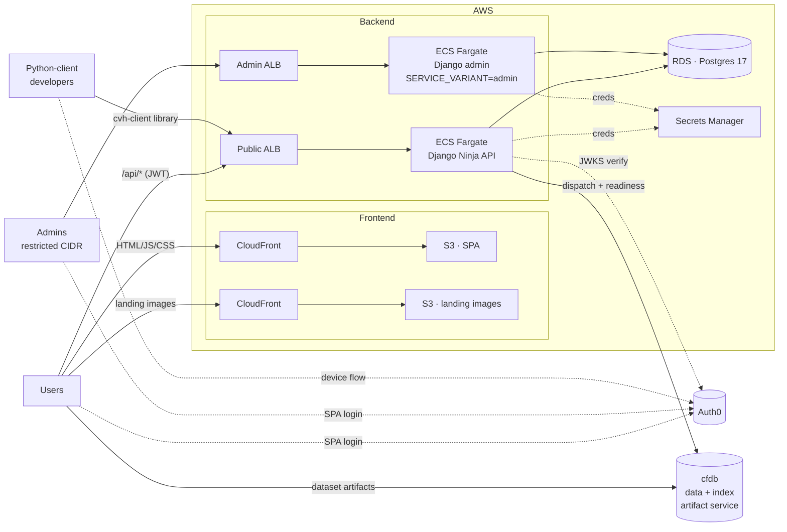

# Architecture

High-level view of CVH's runtime topology.

## Notes

- The frontend bundles `gosling-designer-vec` and `vitessce` at build time — they are npm dependencies, not runtime services.
- Both ECS services run the *same* Docker image; only the `SERVICE_VARIANT` env var differs. See [`admin-deployment.md`](./admin-deployment.md) for the admin variant setup.
- The `cvh-client` Python package (published to PyPI) hits the same `/api/*` endpoints as the browser SPA.
- **cfdb** is an external artifact service run by the CFDE program. The backend dispatches processing jobs and probes readiness (`GET /{data,index}/{dcc}/{id}[/status]`); the browser fetches processed dataset artifacts directly. See `backend/core/api/cfdb.py` and `backend/core/api/dccs.py` for the supported DCC list. Dataset URLs may also point to S3 or arbitrary HTTP hosts — cfdb is one of several sources.
- The AWS infrastructure is maintained separately.

